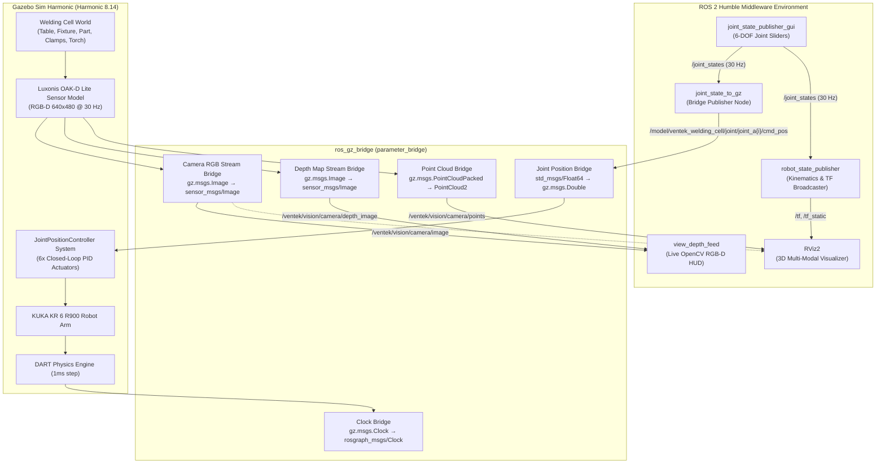
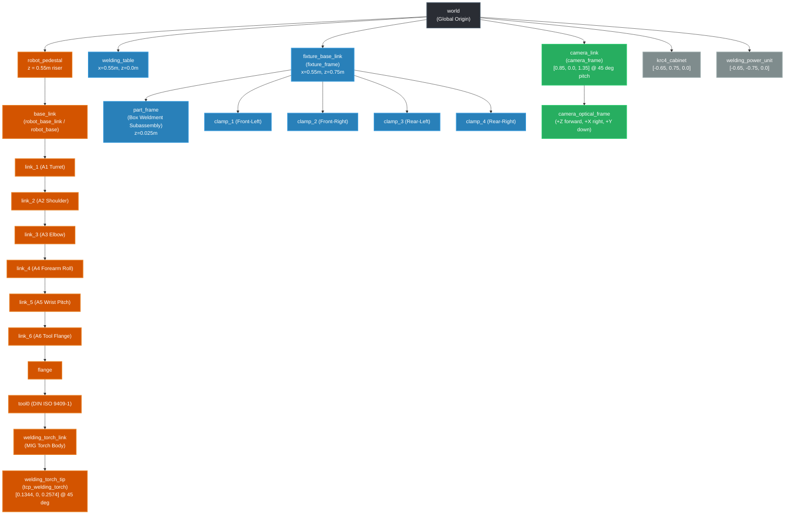
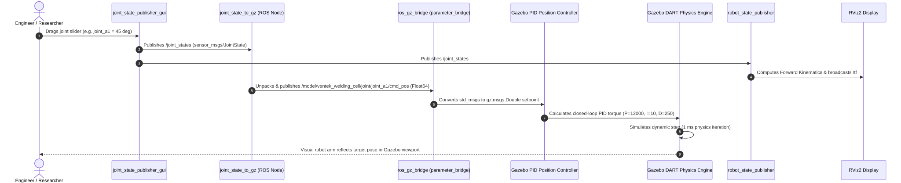
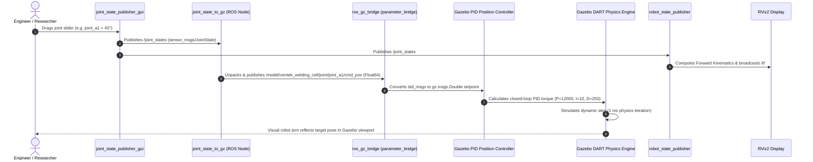
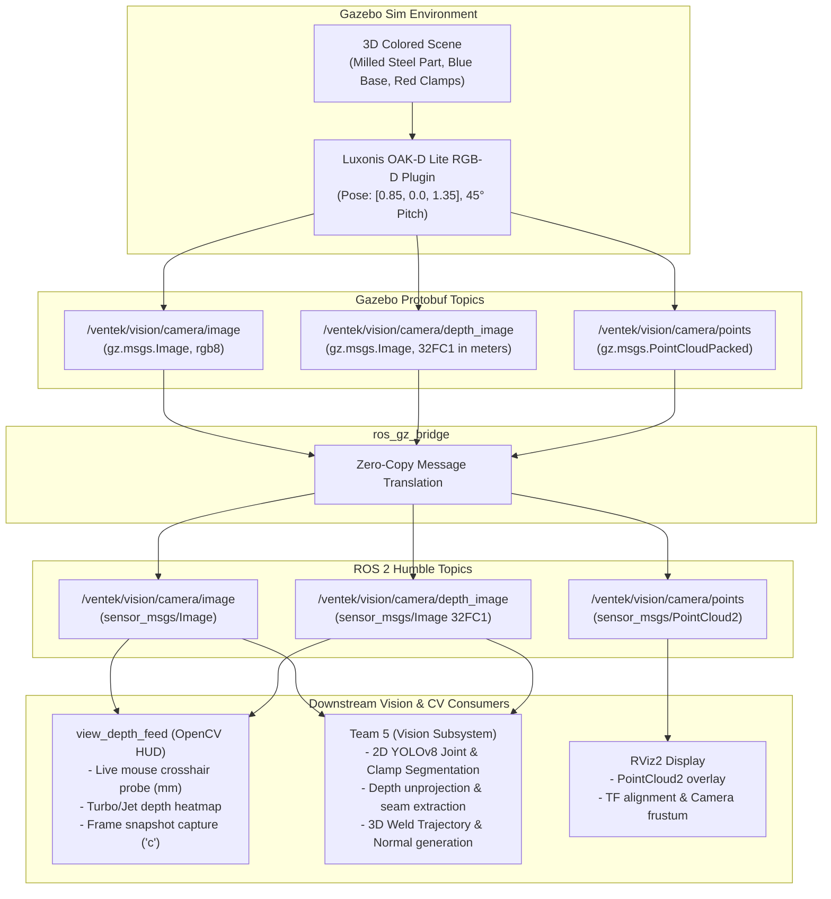

# VENTEK Autonomous Welding — Robotic Cell Simulation Guide

> **Official Technical Reference for Simulation Architecture, Gazebo Harmonic, ROS 2 Middleware, Topic Catalog, and Computer Vision Interfaces**  
> *Target Audience: Team 1 (Cognitive Autonomy), Team 2 (Cell Coordination), Team 3 (Multimodal AI), Team 4 (Adaptive Control), Team 5 (Vision), Team 6 (Path Planning)*

---

## Table of Contents
1. [Executive Summary & Quick Start](#1-executive-summary--quick-start)
2. [End-to-End Simulation Architecture](#2-end-to-end-simulation-architecture)
3. [Physical Cell Model & Coordinate Frames (TF Tree)](#3-physical-cell-model--coordinate-frames-tf-tree)
4. [Visual Styling & Color Differentiation System](#4-visual-styling--color-differentiation-system)
5. [Active ROS 2 Nodes Breakdown](#5-active-ros-2-nodes-breakdown)
6. [Complete Topic Catalog & Interface Contracts](#6-complete-topic-catalog--interface-contracts)
7. [Computer Vision & Sensor Pipeline (Team 5 & Team 1)](#7-computer-vision--sensor-pipeline-team-5--team-1)
8. [Automated Verification & Scenario Testing](#8-automated-verification--scenario-testing)
9. [Developer Runbook & Troubleshooting](#9-developer-runbook--troubleshooting)

---

## 1. Executive Summary & Quick Start

The VENTEK simulation environment replicates a complete industrial robotic welding cell running in **Gazebo Sim Harmonic (gz-sim 8)** bridged to **ROS 2 Humble**.

### Key Simulation Capabilities
- **Physics & Dynamics**: Accurate inertia, mass, kinematic limits, and DART physics solver.
- **RGB-D Sensor Suite**: Industrial Luxonis OAK-D Lite camera generating 30 Hz synchronized RGB streams, metric 32-bit floating-point depth maps, and dense point clouds.
- **Interactive Manual Posing**: Zero-dependency 6-DOF joint slider GUI coupled to real-time closed-loop Gazebo PID position controllers.
- **Industrial Visual Shading**: Dedicated Ogre2 PBR materials preventing sensor overexposure and providing high-contrast color differentiation across all cell fixtures, workpieces, clamps, and tooling.

### Quick Start Commands

```bash
# 1. Build the ROS 2 workspace
source /opt/ros/humble/setup.bash
cd /home/utkarsh/ventek_ws
colcon build --symlink-install
source install/setup.bash

# 2. Run automated cell validation (verifies meshes, TF frames, kinematics, scenarios)
ros2 run ventek_autonomous_welding verify_cell_setup

# 3. Launch full simulation with Gazebo Sim, RViz2, and Joint Slider GUI
ros2 launch ventek_autonomous_welding simulation.launch.py

# 4. (Optional) In a separate terminal, open the OpenCV Live Camera & Depth Viewer
ros2 run ventek_autonomous_welding view_depth_feed
```

#### Launch Configuration Flags
| Argument | Default | Description |
| :--- | :--- | :--- |
| `rviz` | `true` | Opens RViz2 pre-configured with cell models, TF, point cloud, and camera view |
| `gui_slider` | `true` | Launches `joint_state_publisher_gui` and the joint-to-Gazebo forwarder bridge |
| `depth_viewer` | `false` | Launches the OpenCV live depth inspector window with crosshair probe |
| `headless` | `false` | Runs Gazebo server without the GUI (recommended for CI or headless servers) |
| `use_sim_time` | `true` | Synchronizes ROS nodes with Gazebo simulation clock `/clock` |

---

### 💡 How to View Flowcharts & Diagrams in this Markdown File

This guide contains **Mermaid** visual flowcharts and architecture diagrams embedded directly in code blocks. You can view them as graphical diagrams through any of the following methods:

1. **Inside VS Code / Antigravity IDE (Recommended)**:
   - **Side-by-Side Preview**: Press `Ctrl + K` then `V` while viewing this file.
   - **Full Preview**: Press `Ctrl + Shift + V`.
   - **Toolbar Icon**: Click the **"Open Preview to the Side"** button (split icon with a magnifying glass) in the top-right corner of the editor.
   - *Status*: The official [`bierner.markdown-mermaid`](https://marketplace.visualstudio.com/items?itemName=bierner.markdown-mermaid) extension has been pre-installed in your environment, so all flowcharts render into interactive SVG graphics automatically.

2. **On GitHub / GitLab**:
   - Whenever you push or browse this file on GitHub or GitLab, all ```` ```mermaid ```` code blocks automatically render as graphical diagrams.

3. **Interactive Online Sandbox**:
   - Copy any ```` ```mermaid ... ``` ```` block and paste it into [mermaid.live](https://mermaid.live) to edit nodes, test layouts, or export high-res PNG/SVG images for team presentations.

---

## 2. End-to-End Simulation Architecture

The following diagram illustrates how the ROS 2 ecosystem interfaces with Gazebo Sim Harmonic:



<details>
<summary><b>Click to expand raw Mermaid source code</b></summary>



</details>

---

## 3. Physical Cell Model & Coordinate Frames (TF Tree)

The simulation uses a unified URDF macro architecture defined in [`welding_cell.urdf.xacro`](file:///home/utkarsh/ventek_ws/ventek_project/ventek_autonomous_welding/urdf/welding_cell/welding_cell.urdf.xacro). All sub-assemblies are rigidly attached to the global `world` frame or their respective kinematic parents.



<details>
<summary><b>Click to expand raw Mermaid source code</b></summary>



</details>

### Complete TF Coordinate Frame Specification

| Frame ID | Parent Frame | Translation `(x, y, z)` [m] | Rotation `(r, p, y)` [rad] | Purpose / Description |
| :--- | :--- | :--- | :--- | :--- |
| `world` | *Root* | `(0, 0, 0)` | `(0, 0, 0)` | Global simulation datum (workshop floor level) |
| `robot_pedestal` | `world` | `(0, 0, 0)` | `(0, 0, 0)` | Riser pedestal base (height = 0.55 m, radius = 0.18 m) |
| `base_link` | `robot_pedestal` | `(0, 0, 0.55)` | `(0, 0, 0)` | KUKA KR 6 R900 robot base plate mounting flange |
| `robot_base_link` | `base_link` | `(0, 0, 0)` | `(0, 0, 0)` | Alias frame for ROS industrial standard naming |
| `robot_base` | `base_link` | `(0, 0, 0)` | `(0, 0, 0)` | Alias frame for legacy KUKA controllers |
| `link_1` | `base_link` | `(0, 0, 0.400)` | `(0, 0, 0)` | Axis 1 (A1) revolute turret (±170°) |
| `link_2` | `link_1` | `(0.025, 0, 0)` | `(0, 0, 0)` | Axis 2 (A2) revolute shoulder (-190° / +45°) |
| `link_3` | `link_2` | `(0.455, 0, 0)` | `(0, 0, 0)` | Axis 3 (A3) revolute elbow (-120° / +156°) |
| `link_4` | `link_3` | `(0, 0, 0.035)` | `(0, 0, 0)` | Axis 4 (A4) revolute forearm roll (±185°) |
| `link_5` | `link_4` | `(0.420, 0, 0)` | `(0, 0, 0)` | Axis 5 (A5) revolute wrist pitch (±120°) |
| `link_6` | `link_5` | `(0.080, 0, 0)` | `(0, 0, 0)` | Axis 6 (A6) revolute tool mount flange (±350°) |
| `flange` | `link_6` | `(0, 0, 0)` | `(0, 0, 0)` | Mechanical mounting face |
| `tool0` | `flange` | `(0, 0, 0)` | `(0, π/2, 0)` | Standard DIN ISO 9409-1-50 flange interface frame |
| `welding_torch_link` | `tool0` | `(0, 0, 0)` | `(0, 0, 0)` | MIG torch mounting adapter body |
| `welding_torch_tip` | `welding_torch_link` | `(0.1344, 0, 0.2574)` | `(0, π/4, 0)` | **Tool Center Point (TCP)** at the wire stick-out |
| `tcp_welding_torch` | `welding_torch_tip` | `(0, 0, 0)` | `(0, 0, 0)` | Alias matching path planning contracts |
| `welding_table` | `world` | `(0.55, 0.0, 0.0)` | `(0, 0, 0)` | Modular 3D table (1.2m x 0.8m x 0.75m high) |
| `fixture_base_link` | `world` | `(0.55, 0.0, 0.75)` | `(0, 0, 0)` | Precision tooling base plate mounted on table top |
| `fixture_frame` | `fixture_base_link` | `(0, 0, 0)` | `(0, 0, 0)` | Alias frame for fixture coordinate systems |
| `part_frame` | `fixture_base_link` | `(0, 0, 0.025)` | `(0, 0, 0)` | Workpiece datum origin (bottom center of part) |
| `clamp_1` | `fixture_base_link` | `(-0.14, -0.13, 0.025)` | `(0, 0, π/2)` | Front-Left Destaco vertical toggle clamp |
| `clamp_2` | `fixture_base_link` | `(0.14, -0.13, 0.025)` | `(0, 0, π/2)` | Front-Right Destaco vertical toggle clamp |
| `clamp_3` | `fixture_base_link` | `(-0.14, 0.13, 0.025)` | `(0, 0, -π/2)` | Rear-Left Destaco vertical toggle clamp |
| `clamp_4` | `fixture_base_link` | `(0.14, 0.13, 0.025)` | `(0, 0, -π/2)` | Rear-Right Destaco vertical toggle clamp |
| `camera_link` | `world` | `(0.85, 0.0, 1.35)` | `(0, π/4, π)` | OAK-D Lite camera body (pitch down 45° toward part) |
| `camera_optical_frame` | `camera_link` | `(0, 0, 0)` | `(-π/2, 0, -π/2)` | Standard optical frame (+Z forward, +X right, +Y down) |
| `camera_frame` | `camera_link` | `(0, 0, 0)` | `(0, 0, 0)` | Alias matching vision pipeline contracts |
| `krc4_cabinet` | `world` | `(-0.65, 0.75, 0.0)` | `(0, 0, 0)` | KUKA KRC4 controller cabinet footprint |
| `welding_power_unit` | `world` | `(-0.65, -0.75, 0.0)` | `(0, 0, 0)` | Fronius/Miller industrial MIG welding power unit |

---

## 4. Visual Styling & Color Differentiation System

### Technical Background: The "Solid White" Problem
In Gazebo Sim Harmonic using the **Ogre2 rendering engine**, when a visual mesh is parsed from a URDF without an explicit `<gazebo reference="...">` material block containing `<ambient>` and `<diffuse>`, Ogre2 applies its fallback default material: an unlit pure white `#FFFFFF` surface. Furthermore, with directional sun lighting, untextured meshes reflect at 100% saturation, completely washing out camera feeds.

To solve this, explicit materials were embedded in both standard URDF `<material>` (for RViz2) and `<gazebo reference="...">` (for Gazebo Sim):

### Cell Component Color Palette

| Component | Target Appearance | Hex Code | Ambient / Diffuse RGBA | Specular | Visual Rationale |
| :--- | :--- | :--- | :--- | :--- | :--- |
| **Welding Table** | Dark Slate Cast Iron | `#383D47` | `(0.18, 0.20, 0.23, 1.0)` / `(0.22, 0.24, 0.28, 1.0)` | `(0.30, 0.30, 0.35)` | Replicates Siegmund/Demmeler plasma-nitrided steel tables. High contrast with part. |
| **Fixture Base Plate** | Tooling Anodized Blue | `#1E59AE` | `(0.08, 0.24, 0.50, 1.0)` / `(0.12, 0.35, 0.68, 1.0)` | `(0.40, 0.40, 0.50)` | Industrial blue fixturing subplate. Immediately distinguishable from table and part. |
| **Workpiece (Part)** | Milled Silver Steel | `#C0C4D1` | `(0.45, 0.48, 0.52, 1.0)` / `(0.75, 0.77, 0.82, 1.0)` | `(0.60, 0.60, 0.65)` | Bright metallic surface for realistic weld seam feature extraction in computer vision. |
| **Toggle Clamps (4x)** | Destaco Safety Red | `#D91E1E` | `(0.55, 0.08, 0.08, 1.0)` / `(0.85, 0.12, 0.12, 1.0)` | `(0.35, 0.25, 0.25)` | Standard industrial vinyl handle color. Simplifies clamp obstacle segmentation. |
| **OAK-D Lite Camera** | Stealth Matte Black | `#1A1A1E` | `(0.06, 0.06, 0.08, 1.0)` / `(0.10, 0.10, 0.12, 1.0)` | `(0.20, 0.20, 0.20)` | Matte anodized camera enclosure hovering above the table. |
| **Welding Gun** | Polished Brass / Copper | `#E08C2E` | `(0.60, 0.35, 0.10, 1.0)` / `(0.88, 0.55, 0.18, 1.0)` | `(0.70, 0.55, 0.30)` | Gas nozzle color stands out against robot wrist and table during weld tracking. |
| **KUKA KR 6 R900** | KUKA Industrial Orange | `#F55414` | `(0.96, 0.33, 0.08, 1.0)` / `(0.96, 0.33, 0.08, 1.0)` | Standard | Official KUKA industrial brand color scheme on links 1–5; graphite on base & link 6. |

---

## 5. Active ROS 2 Nodes Breakdown

The following sequence diagram tracks the real-time execution flow when a user manipulates a joint slider:



<details>
<summary><b>Click to expand raw Mermaid source code</b></summary>



</details>

### 1. `robot_state_publisher`
- **Executable**: `robot_state_publisher`
- **Package**: `robot_state_publisher`
- **Function**: Parses the unified Xacro string (`welding_cell.urdf.xacro`), subscribes to `/joint_states`, and computes full 3D Forward Kinematics, continuously broadcasting dynamic transforms to `/tf` and static frames to `/tf_static`.

### 2. `gz_sim`
- **Command**: `gz sim -r simulation/worlds/welding_cell.sdf`
- **Function**: The main Gazebo Sim Harmonic physics and rendering server.
- **Embedded Plugins**:
  - `gz-sim-physics-system`: Executes DART dynamics calculations.
  - `gz-sim-sensors-system`: Executes the Ogre2 sensor rendering pipeline for cameras.
  - `gz-sim-scene-broadcaster-system`: Streams visual entity states to the Gazebo GUI.
  - `gz::sim::systems::JointPositionController`: 6 instances (one per robot joint) maintaining PID joint position tracking inside Gazebo.

### 3. `ros_gz_sim (spawner)`
- **Executable**: `create`
- **Package**: `ros_gz_sim`
- **Function**: Spawns the parsed URDF XML into the active Gazebo world under the entity name `ventek_welding_cell` with a 2-second delay to guarantee Gazebo world initialization.

### 4. `ros_gz_bridge (parameter_bridge)`
- **Executable**: `parameter_bridge`
- **Package**: `ros_gz_bridge`
- **Function**: Provides zero-copy memory translation between ROS 2 Humble messages and Gazebo Sim Protobuf messages for camera feeds, clock, and joint control commands.

### 5. `joint_state_publisher_gui`
- **Executable**: `joint_state_publisher_gui`
- **Package**: `joint_state_publisher_gui`
- **Function**: Provides an interactive desktop slider window with sliders for `joint_a1` through `joint_a6`, publishing real-time `sensor_msgs/JointState` messages at 30 Hz.

### 6. `joint_state_to_gz`
- **Executable**: `joint_state_to_gz`
- **Script**: [`scripts/joint_state_to_gz.py`](file:///home/utkarsh/ventek_ws/ventek_project/ventek_autonomous_welding/scripts/joint_state_to_gz.py)
- **Package**: `ventek_autonomous_welding`
- **Function**: Subscribes to `/joint_states`, unpacks joint angle values, and publishes individual `std_msgs/Float64` messages to `/model/ventek_welding_cell/joint/joint_a{i}/cmd_pos`, closing the loop between the GUI sliders and the Gazebo simulation robot.

### 7. `live_depth_viewer`
- **Executable**: `view_depth_feed`
- **Script**: [`scripts/view_depth_feed.py`](file:///home/utkarsh/ventek_ws/ventek_project/ventek_autonomous_welding/scripts/view_depth_feed.py)
- **Package**: `ventek_autonomous_welding`
- **Function**: Real-time OpenCV GUI tool providing side-by-side colorized depth heatmap + RGB stream, an interactive distance probe on mouse hover, distance statistics HUD, and snapshot capture.

### 8. `rviz2`
- **Executable**: `rviz2`
- **Package**: `rviz2`
- **Function**: 3D visualization loading [`config/welding_cell.rviz`](file:///home/utkarsh/ventek_ws/ventek_project/ventek_autonomous_welding/config/welding_cell.rviz) with robot models, point clouds, TF frames, and camera overlays.

---

## 6. Complete Topic Catalog & Interface Contracts

| ROS 2 Topic | Gazebo Sim Topic | Direction | ROS 2 Type | Gazebo Type | Rate | Description |
| :--- | :--- | :--- | :--- | :--- | :--- | :--- |
| `/clock` | `/clock` | GZ -> ROS | `rosgraph_msgs/msg/Clock` | `gz.msgs.Clock` | 1000 Hz | Simulation clock time synchronization |
| `/joint_states` | *N/A (Internal ROS)* | Internal | `sensor_msgs/msg/JointState` | *N/A* | 30 Hz | Current/commanded joint angles from slider GUI |
| `/robot_description` | *N/A (Latched)* | Pub -> All | `std_msgs/msg/String` | *N/A* | Latched | Complete Xacro-generated URDF string of cell |
| `/tf` | *N/A (Internal ROS)* | Pub -> All | `tf2_msgs/msg/TFMessage` | *N/A* | 30 Hz | Dynamic coordinate transforms for robot arm |
| `/tf_static` | *N/A (Latched)* | Pub -> All | `tf2_msgs/msg/TFMessage` | *N/A* | Latched | Static transforms (table, fixture, camera, TCP) |
| `/ventek/vision/camera/image` | `/ventek/vision/camera/image` | GZ -> ROS | `sensor_msgs/msg/Image` | `gz.msgs.Image` | 30 Hz | OAK-D Lite RGB camera feed (640x480, `rgb8`) |
| `/ventek/vision/camera/depth_image` | `/ventek/vision/camera/depth_image` | GZ -> ROS | `sensor_msgs/msg/Image` | `gz.msgs.Image` | 30 Hz | Metric raw depth map (640x480, `32FC1`, in meters) |
| `/ventek/vision/camera/points` | `/ventek/vision/camera/points` | GZ -> ROS | `sensor_msgs/msg/PointCloud2` | `gz.msgs.PointCloudPacked` | 10 Hz | 3D colored point cloud in `camera_optical_frame` |
| `/ventek/vision/camera/camera_info` | `/ventek/vision/camera/camera_info` | GZ -> ROS | `sensor_msgs/msg/CameraInfo` | `gz.msgs.CameraInfo` | 30 Hz | Intrinsic calibration matrix ($f_x, f_y, c_x, c_y$) |
| `/model/ventek_welding_cell/joint/joint_a1/cmd_pos` | *same* | ROS -> GZ | `std_msgs/msg/Float64` | `gz.msgs.Double` | 30 Hz | Position setpoint for Axis A1 turret PID |
| `/model/ventek_welding_cell/joint/joint_a2/cmd_pos` | *same* | ROS -> GZ | `std_msgs/msg/Float64` | `gz.msgs.Double` | 30 Hz | Position setpoint for Axis A2 shoulder PID |
| `/model/ventek_welding_cell/joint/joint_a3/cmd_pos` | *same* | ROS -> GZ | `std_msgs/msg/Float64` | `gz.msgs.Double` | 30 Hz | Position setpoint for Axis A3 elbow PID |
| `/model/ventek_welding_cell/joint/joint_a4/cmd_pos` | *same* | ROS -> GZ | `std_msgs/msg/Float64` | `gz.msgs.Double` | 30 Hz | Position setpoint for Axis A4 forearm roll PID |
| `/model/ventek_welding_cell/joint/joint_a5/cmd_pos` | *same* | ROS -> GZ | `std_msgs/msg/Float64` | `gz.msgs.Double` | 30 Hz | Position setpoint for Axis A5 wrist pitch PID |
| `/model/ventek_welding_cell/joint/joint_a6/cmd_pos` | *same* | ROS -> GZ | `std_msgs/msg/Float64` | `gz.msgs.Double` | 30 Hz | Position setpoint for Axis A6 tool roll PID |

---

## 7. Computer Vision & Sensor Pipeline (Team 5 & Team 1)

The following flowchart illustrates the transformation pipeline from raw Gazebo physical photons to downstream OpenCV/YOLOv8 algorithms and point clouds:



<details>
<summary><b>Click to expand raw Mermaid source code</b></summary>



</details>

### Sensor Specifications
- **Sensor Type**: Gazebo RGB-D Camera (`rgbd_camera`)
- **Mount Pose**: `x=0.85m, y=0.0m, z=1.35m`, pitch 45° down (`rpy="0 0.785398 3.141592"`)
- **Horizontal FOV**: $1.204\text{ rad} \approx 69^\circ$
- **Resolution**: $640 \times 480$ pixels
- **Clip Range**: Near = 0.15 m, Far = 4.0 m
- **Workpiece Working Distance**: $\approx 0.85\text{ m}$ (within the optimal high-accuracy range of OAK-D Lite)

### Python Subscriber Snippet: Consuming Depth Maps & Point Clouds
Team 5 and Team 1 can use the following standard boilerplate to subscribe to depth maps and point clouds:

```python
import rclpy
from rclpy.node import Node
from sensor_msgs.msg import Image, PointCloud2
from cv_bridge import CvBridge
import numpy as np

class VisionPipelineNode(Node):
    def __init__(self):
        super().__init__('vision_pipeline_node')
        self.bridge = CvBridge()
        
        # Subscribe to 32FC1 depth map (raw metric values)
        self.depth_sub = self.create_subscription(
            Image,
            '/ventek/vision/camera/depth_image',
            self.depth_callback,
            10
        )
        
        # Subscribe to RGB feed
        self.rgb_sub = self.create_subscription(
            Image,
            '/ventek/vision/camera/image',
            self.rgb_callback,
            10
        )

    def depth_callback(self, msg: Image):
        # Convert ROS Image to 2D NumPy array of float32 (values in meters)
        depth_map = self.bridge.imgmsg_to_cv2(msg, desired_encoding='32FC1')
        
        # Valid depth mask (filter NaNs / Infs)
        valid = np.isfinite(depth_map) & (depth_map > 0.15) & (depth_map < 3.0)
        center_dist = depth_map[240, 320]
        self.get_logger().info(f'Part Center Depth: {center_dist * 1000.0:.1f} mm')

    def rgb_callback(self, msg: Image):
        # Convert RGB image for YOLOv8 segmentation
        rgb_image = self.bridge.imgmsg_to_cv2(msg, desired_encoding='bgr8')
        # Pass to YOLOv8 / OpenCV ...
```

### Live Depth Viewer Keyboard Controls
When running `ros2 run ventek_autonomous_welding view_depth_feed`:
- **Mouse Hover**: Point at any pixel to read the instantaneous 3D distance in millimeters and $(X, Y)$ pixel coordinates.
- **`s` Key**: Toggle between Combined Side-by-Side (RGB + Depth Heatmap) and Single Depth-Only mode.
- **`c` Key**: Capture a timestamped PNG snapshot of RGB and Depth frames to disk.
- **`q` or `ESC`**: Quit the viewer safely.

---

## 8. Automated Verification & Scenario Testing

The package includes a comprehensive automated validation script that runs 25+ checks across the entire cell setup.

```bash
ros2 run ventek_autonomous_welding verify_cell_setup
```

### Validation Test Suites
1. **3D Mesh Integrity**: Checks existence and byte size for all robot visual/collision meshes, welding table, fixture base, workpiece models (nominal, butt joint, T-joint), clamps, and OAK-D Lite.
2. **Kinematic Structure**: Validates all 28 coordinate frames and verifies TCP offset `[0.1344, 0.0, 0.2574]`.
3. **Kinematic Reachability**: Validates reachability of Seam 1 (start, mid, end) against the KUKA 901 mm spherical workspace envelope, and tests out-of-reach rejection.
4. **Collision & Interference**: Confirms nominal clamp clearance ($\approx 70.4\text{ mm}$) and validates collision flags under clamp obstruction scenarios.
5. **Contract Interfaces**: Validates JSON schema files in [`data/mock_contracts/`](file:///home/utkarsh/ventek_ws/ventek_project/ventek_autonomous_welding/data/mock_contracts/) used for inter-team handoffs (`scene_nominal.json`, `trajectory_nominal.json`, `cell_state_nominal.json`).

---

## 9. Developer Runbook & Troubleshooting

### Issue 1: Orphaned Gazebo Sim Server Processes
**Symptom**: `Address already in use` error or simulation clock not advancing when launching.  
**Cause**: A previous Gazebo simulation instance was terminated with `Ctrl+Z` or crashed, leaving the background server running.  
**Fix**:
```bash
pkill -9 -f 'gz sim server'
pkill -9 -f 'parameter_bridge'
```
*(Note: `simulation.launch.py` now automatically executes `pkill -9 -f 'gz sim server'` at startup to prevent this).*

### Issue 2: Mesh Loading Fails or Models Invisible in Gazebo
**Symptom**: Models load in RViz but are missing in Gazebo Sim.  
**Cause**: Gazebo Sim cannot locate package meshes without `GZ_SIM_RESOURCE_PATH`.  
**Fix**: Ensure your shell has sourced the workspace install:
```bash
source /opt/ros/humble/setup.bash
source /home/utkarsh/ventek_ws/install/setup.bash
```
The launch script automatically sets `GZ_SIM_RESOURCE_PATH` across package source and install directories.

### Issue 3: Stale Joint State Positions
**Symptom**: Sliders move in GUI but the robot in Gazebo does not move.  
**Cause**: `joint_state_to_gz` bridge node is not running or the Gazebo simulation is paused.  
**Fix**: 
1. Check the play button in Gazebo GUI (bottom-left) to make sure simulation is playing.
2. Check that the bridge node is active:
```bash
ros2 node list | grep joint_state_to_gz
ros2 topic echo /model/ventek_welding_cell/joint/joint_a1/cmd_pos
```

### Issue 4: Camera Output Flickering or Vanishing
**Symptom**: Image viewer window opens and closes rapidly.  
**Cause**: The subscriber QoS must match the reliable publisher QoS from `ros_gz_bridge`.  
**Fix**: Use `LiveDepthViewer` with `QoSProfile(reliability=ReliabilityPolicy.RELIABLE, history=HistoryPolicy.KEEP_LAST, depth=10)`. This is pre-configured in `view_depth_feed.py`.

---

*Maintained by VENTEK Autonomous Welding Systems Team. For updates or feature additions, submit a PR to the repository.*
